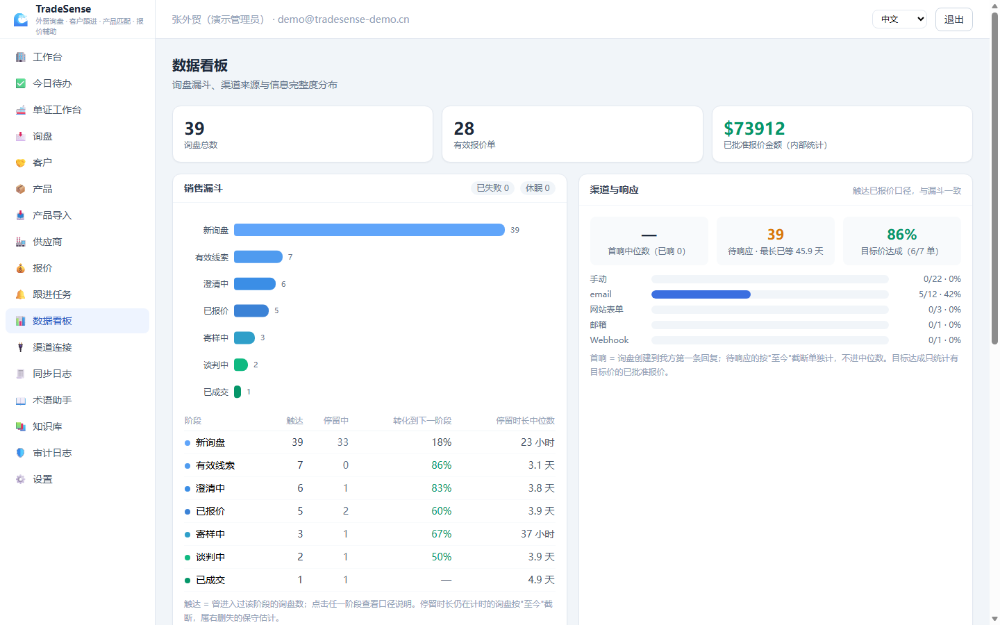
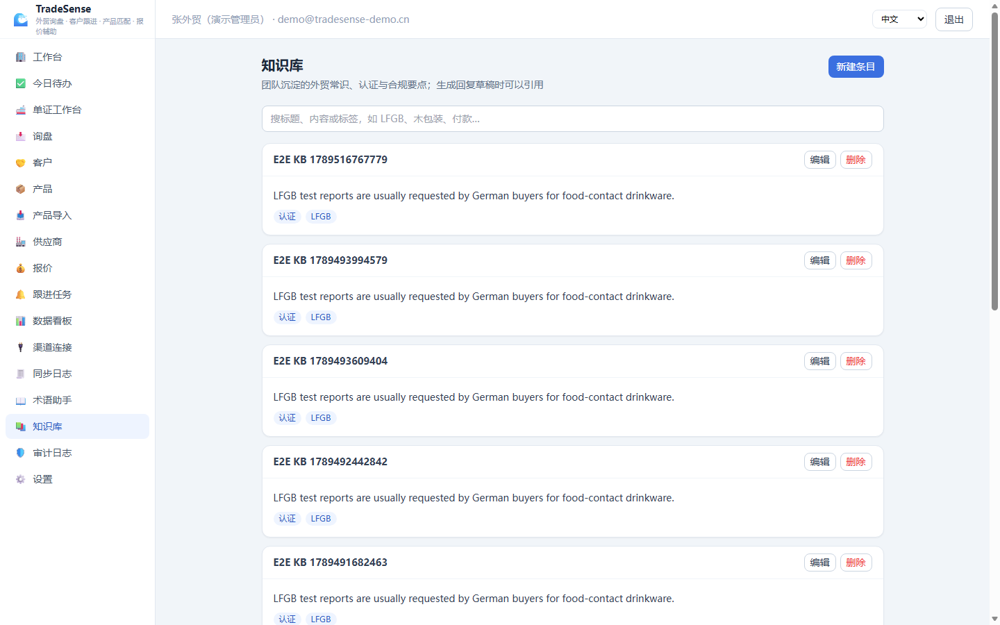

# TradeSense

[](https://github.com/Aisiweiyang/tradesense/actions/workflows/ci.yml)

**中文 | [English](README.en.md)**

**AI 外贸询盘、客户跟进、产品匹配与报价辅助平台**

面向刚开始做外贸的个人和小团队：产品资料散落在 Excel 里、通过邮件/WhatsApp/网站表单收询盘、英文沟通吃力、不知道该追问什么、容易漏掉报价条件和跟进时间。TradeSense 定位是业务员的**副驾驶**——帮助理解客户、整理需求、寻找产品、发现风险、撰写回复、计算报价、跟踪客户；**所有重要承诺（正式报价、对外回复）都由人工确认**，系统绝不自动发送。

## ✨ 核心能力

| 能力 | 说明 |
| --- | --- |
| 📩 多渠道询盘 | 手动粘贴、邮箱（IMAP）、WhatsApp Cloud API、独立站表单+聊天组件、通用 Webhook（n8n/Zapier/Make）；缺凭据时使用**明确标注的模拟连接器**，不伪造已连接 |
| 🧩 多轮需求状态 | 每个字段记录当前值/历史值/置信度/来源消息；支持修改、否定、"无所谓"、矛盾、人工锁定，锁定字段不会被自动覆盖 |
| 📊 询盘完整度 | 不透明分数 → 明确列出已确认/待确认/当前不能正式报价的原因 |
| 🎯 两阶段产品匹配 | 召回（同义词+全文）→ 确定性重排序（权重可配置）；硬条件不满足直接淘汰并**显示原因** |
| ❓ 智能追问 | 每轮只推 1 个主问题 + 次要清单，附"为什么问这个"（法规/报价阻塞 > 矛盾 > 信息增益 > 偏好） |
| 💰 确定性报价 | 程序按阶梯价+包装/印刷/物流/保险/关税计算，展示每一行的数据来源；内部成本/建议价/客户价/批准价四分离，**人工批准才算正式报价** |
| 🚢 单证工作台 | 货件/单证上传提取（页码级证据）/跨单证一致性规则/异常队列/催补邮件（第四阶段，见 docs/18）
| 💼 比价与报价单 | 多供应商比价排序、合并报价单 PDF 导出（内部成本永不外泄）、固定四角色审批矩阵（见 docs/19）
| 📈 销售漏斗 | 九阶段漏斗（新询盘→成交）：触达数、相邻转化率、阶段停留时长中位数（右删失口径），创建/报价/成交自动记录（见 docs/20）
| 📚 知识库 | 团队共享外贸常识（认证/合规/惯例），生成回复草稿时可引用条目并标注来源（见 docs/20）
| 💱 汇率配置 | 手工维护币种对汇率（不接外部 API），跨币种报价自动折算并标注来源，无配置时明确提示（见 docs/20）
| ✉️ 回复草稿 | 10 类场景 × 3 种语气，英文正文+中文对照，标注使用了哪些事实、发送前需人工确认什么 |
| 🔔 跟进提醒 | 今日待办、超期、报价后未回复、长期沉默、高意向、信息不完整，每条建议有依据 |
| 🛡️ 安全边界 | 组织隔离、PBKDF2 密码、审计日志、上传限制、AI 输出白名单校验、永不自动发送 |

## 🚀 快速开始（Windows 一键）

```bat
:: 1. 进入项目目录
cd 外贸询盘助手\scripts
:: 2. 双击或运行
start_dev.bat
```

脚本会自动：创建 Python venv → 安装依赖 → 初始化数据库（Alembic 迁移 + 演示数据）→ 启动前后端 → 打开浏览器。

- 前端：http://127.0.0.1:5173
- 后端 API：http://127.0.0.1:8001 ｜ OpenAPI 文档：http://127.0.0.1:8001/docs
- **演示账号：`demo@tradesense-demo.cn` / `demo1234`**

macOS/Linux：`bash scripts/start_dev.sh`

如需换端口，在启动前设置 `TRADESENSE_BACKEND_PORT` 和 `TRADESENSE_FRONTEND_PORT`；Vite 代理会自动跟随后端端口，无需修改源码。

### 手动启动

```bash
# 后端
cd backend
python -m venv .venv && .venv/Scripts/pip install -r requirements.txt   # Windows
.venv/Scripts/python scripts/init_db.py     # 迁移 + 演示数据
.venv/Scripts/python -m uvicorn app.main:app --port 8001

# 前端（新开终端）
cd frontend
npm install
npm run dev        # http://127.0.0.1:5173
```

### Docker 部署

```bash
docker compose up --build
# 前端 http://localhost:5173 (nginx, /api 反代到后端)
```

## 🧪 测试

```bash
cd backend && .venv/Scripts/python -m pytest      # 242 个测试：单元+API+场景+隔离+幂等+权限+漏斗/知识库/汇率/洞察
cd frontend && npx vitest run                      # 36 个测试：组件+i18n+API 客户端+页面冒烟+新功能
cd frontend && npx playwright test                 # 5 条浏览器 E2E 链路（需先启动前后端）
```

## 🖼️ 界面速览





更多截图见 [docs/phase1-screenshots/](docs/phase1-screenshots/)。

## ❓ FAQ

**必须配置 AI 密钥吗？**
不需要。无 AI 时全部核心流程可用（确定性模式），AI 仅用于可选的摘要润色，且输出需人工确认。

**数据存在哪里？**
默认单文件 SQLite（`backend/data/`，自动创建）；可切换 PostgreSQL（见 docs/03）。所有业务数据按组织隔离。

**系统会替我发邮件吗？**
不会。报价需人工批准、回复草稿需人工批准后自行发送，系统永不自动发送任何消息。

**端口被占用怎么办？**
启动前设置 `TRADESENSE_BACKEND_PORT` / `TRADESENSE_FRONTEND_PORT` 即可，详见 docs/02。

## 📁 目录结构

```
外贸询盘助手/
├── backend/                 FastAPI + SQLAlchemy 2 + Alembic (Python 3.13)
│   ├── app/
│   │   ├── models/          27 张业务表，全部按组织隔离
│   │   ├── services/        需求状态引擎、匹配、追问、报价、草稿、连接器、AI 适配
│   │   ├── api/routes/      REST API（统一错误/分页/权限）
│   │   └── seed/            演示数据（42 产品 / 19 询盘 / 10 场景）
│   ├── data/                SQLite 数据文件（运行时自动创建，不入库）
│   ├── alembic/             数据库迁移
│   ├── scripts/             后端管理命令（init_db.py，与 Docker 镜像上下文绑定）
│   └── tests/               pytest 测试套件
├── frontend/                React 18 + TypeScript + Vite + Tailwind
│   ├── src/pages/           19 个页面（中文界面，可切英文）
│   └── e2e/                 Playwright 浏览器端到端测试
├── docs/                    22 篇文档（快速开始/使用手册/算法/接入/单证工作台/比价/漏斗与知识库/限制/交付报告）
│   └── phase1-screenshots/  第一阶段界面验收截图
├── scripts/                 跨端开发工具（一键启动、页面截图）
├── logs/                    开发日志（运行时产生，不入库）
└── docker-compose.yml
```

## 📖 文档索引

| 文档 | 内容 |
| --- | --- |
| [docs/01-新手快速开始.md](docs/01-新手快速开始.md) | 第一次用？从粘贴一封询盘开始 |
| [docs/02-本地启动.md](docs/02-本地启动.md) | 手动启动 / 环境变量 / 常见问题 |
| [docs/03-Docker部署.md](docs/03-Docker部署.md) | compose / PostgreSQL 生产模式 |
| [docs/04-产品数据导入.md](docs/04-产品数据导入.md) | CSV/Excel 模板、字段映射、校验规则 |
| [docs/05-外部渠道接入.md](docs/05-外部渠道接入.md) | 邮箱/WhatsApp/表单/Webhook/n8n 接入 |
| [docs/06-系统架构.md](docs/06-系统架构.md) | 技术栈、模块划分、数据流 |
| [docs/07-数据模型.md](docs/07-数据模型.md) | 全部实体与关系 |
| [docs/08-多轮状态算法.md](docs/08-多轮状态算法.md) | 槽位状态机、锁定、冲突、历史 |
| [docs/09-搜索与排序算法.md](docs/09-搜索与排序算法.md) | 两阶段检索、硬条件、权重 |
| [docs/10-报价计算.md](docs/10-报价计算.md) | EXW/FOB/CIF/DDP 计算口径与来源标注 |
| [docs/11-AI安全边界.md](docs/11-AI安全边界.md) | AI 能做什么/不能做什么/降级策略 |
| [docs/12-权限与数据隔离.md](docs/12-权限与数据隔离.md) | 组织隔离、审计、脱敏 |
| [docs/13-测试说明.md](docs/13-测试说明.md) | 测试矩阵与运行方式 |
| [docs/14-已知限制.md](docs/14-已知限制.md) | 当前版本的限制与注意事项 |
| [docs/15-后续路线图.md](docs/15-后续路线图.md) | P2 与后续方向 |
| [docs/17-优化日志.md](docs/17-优化日志.md) | 三轮+第四阶段有记录的优化（问题→修复→验证） |
| [docs/18-单证工作台.md](docs/18-单证工作台.md) | 货件、单证核验、异常队列、催补邮件 |
| [docs/19-比价与报价单.md](docs/19-比价与报价单.md) | 供应商比价、合并报价单、权限矩阵 |
| [docs/20-漏斗与知识库.md](docs/20-漏斗与知识库.md) | 销售漏斗口径、知识库用法、汇率优先级 |
| [docs/21-使用手册.md](docs/21-使用手册.md) | 使用者的完整操作手册：日常流程/权限/FAQ |
| [docs/22-项目介绍与开发指南.md](docs/22-项目介绍与开发指南.md) | 项目全景：功能、代码导读、开发与调试指南 |

## 🔑 设计原则（与实现一致）

1. **AI 不碰确定性逻辑**：价格由程序算、硬条件由程序判，AI 只做摘要/润色且必须人工确认。
2. **人不被系统绑架**：所有建议可忽略/修改，正式输出（报价、回复）必须人工批准。
3. **新手可理解**：完整度给原因、匹配给解释、报价给依据、追问给理由。
4. **没有凭据也能跑**：无 AI、无邮箱、无 WhatsApp 时全部核心流程可用（模拟连接器明确标注）。

## ⚠️ 重要声明

系统提示（术语解释、关税/认证提醒）仅作业务辅助，**不构成法律、税务、报关或认证结论**；DDP 等条款的税率、目的国合规请以货代与专业机构意见为准。

仓库与文档中的所有客户、供应商、邮箱、单证与报价均为**虚构演示数据**；如部署实例产生真实业务数据，请自行承担保密义务。
